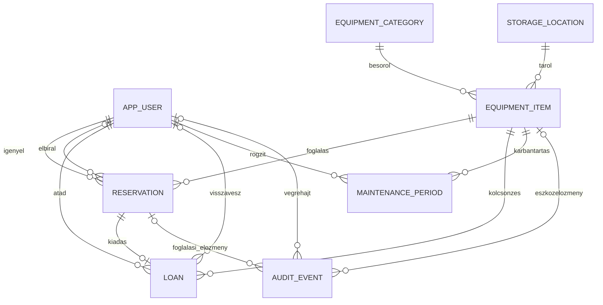

# Adatmodell és technikai döntések

## Kapcsolatok

A részletes mezőlista és adatbáziskorlátok forrása: backend/src/main/resources/db/migration/V1\_\_initial_schema.sql. Az első két egységben hat táblához van JPA-entitás (felhasználó, kategória, helyszín, eszköz, foglalás, auditesemény). A kölcsönzés és karbantartás szerkesztése később készül; a foglalási modul a már létező táblák blokkoló adatait natív lekérdezéssel ellenőrzi. A Flyway saját schema history táblája technikai metaadat, nem kilencedik üzleti entitás.

## ADR-001: PostgreSQL és migráció

Az adatok nem veszhetnek el újraindításkor. A Flyway hozza létre a sémát; Hibernate ddl-auto=validate, OSIV=false. Már alkalmazott migrációt nem írunk át: a későbbi módosítás új V2/V3 fájl. Az SQL CHECK-korlátok nem helyettesítik a service réteg üzleti ellenőrzéseit.

## ADR-002: Egyszerű moduláris monolit

Egy backend, funkciónként auth/user/equipment/reservation/audit/bootstrap/common csomagok. A későbbi loan/maintenance/dashboard csomagok akkor jönnek létre, amikor valódi funkciójuk elkészül. Nincs generikus CRUD-service, repository-wrapper vagy minden service elé üres interfész. A módosításokat a service tranzakciója fogja össze. Az admin felhasználólistát is service készíti DTO-vá, a controller csak HTTP-adapter.

## ADR-003: DTO és MapStruct

Java record request/response típusok. MapStruct compile-time generált Spring komponens, ReportingPolicy.ERROR. EquipmentMapper kategóriát és helyszínt ténylegesen leképez a válaszba; UserMapper nem tud jelszót visszaadni, mert a válaszban nincs ilyen mező. A kapcsolatok service tranzakción belül, EntityGraph-fal töltődnek. A requestből csak engedélyezett skalármezőket képezünk; jogosultság, tulajdonos és állapot service felelőssége.

## ADR-004: JWT és visszavonás

Spring Security ellenőrzi az aláírást, nem saját kriptográfia. A saját validator ellenőrzi az aktuális fiókot/tokenVersiont és audience-t. Az issuer és időbélyeg-validátor megmarad. HS256-hoz egy külső, legalább32bájtos kulcs. Kijelentkezés atomikus adatbázis-increment; minden korábban kiadott token érvénytelen. Szerepváltás/tiltás ellenőrzése kérésenként történik. Nincs refresh token az első kiadásban. A böngészőfrissítés utáni új belépés ismert UX-kompromisszum.

## ADR-005: PostgreSQL Docker nélkül a fejlesztőgépen

A gépen van JDK, de nincs Docker és nincs elérhető normál PostgreSQL. A tesztfüggőségként használt Zonky 2.2.2 + PostgreSQL18.3 natív bináris valódi PostgreSQL-t indít. A LocalDevelopment test-classpathos indító tartós .local/postgres könyvtárat használ, csak loopbacken. A tesztek ettől független, ideiglenes adatbázist futtatnak. A kiadott jar normál PostgreSQL-kapcsolatot vár; nem tartalmazza a fejlesztői indítót. Nem helyettesítjük H2-vel az adatbázist. A későbbi CI-hoz elérhető Docker esetén Testcontainers is alkalmazható.

## ADR-006: Magyar frontend, angol API

Minden látható termékszöveg magyar. Az enumkódokhoz magyar felirat tartozik. React Router védett útvonalak, AuthContext csak belépési állapothoz, TanStack Query szerveradatokhoz. A query cache kijelentkezéskor törlődik, így következő felhasználó nem látja az előző adatait. A token nem kerül tartós böngészőtárba. A katalógus lifecycle címkéje „Az eszköztárban”; nem ígér még nem ellenőrzött szabad időpontot.

## ADR-007: Az eszközsor a foglalási írások közös zárja

Igénylés, jóváhagyás, elutasítás és visszavonás először PESSIMISTIC_WRITE zárral olvassa az eszközsort. Döntésnél az első lekérdezés csak skalár eszközazonosítót tölt be; a foglalás entitása csak a zár megszerzése után kerül a persistence contextbe. PostgreSQL READ COMMITTED mellett az utána futó ütközésvizsgálat már látja az előző tranzakció végleges döntését. A zár csak azonos eszközön sorosít; a globális zárolás szükségtelen.

Az @Version és a kötelező version requestmező az elavult felületből küldött parancsot is visszautasítja. A [kezdés,befejezés) intervallumok szomszédosak lehetnek; az átfedést startA < endB és endA > startB vizsgálja. A függő igény nem biztosít időszakot. Döntés és audit egy tranzakció; a frontend409 után frissíti a szerveradatokat. A későbbi kölcsönzés/karbantartás írásai ugyanezt az eszközsort kell zárolják, hogy megőrizzék az invariánst. Ez alkalmazásszintű garancia: közvetlen SQL-írás nem kerülheti meg a szolgáltatási szabályokat.

## ADR-008: Budapesti dátumbevitel

A datetime-local értéket explicit Europe/Budapest zónával alakítjuk UTC-vé, függetlenül a böngésző helyi zónájától. A nyári/téli óraátállítás hiányzó vagy kétértelmű perceit visszautasítjuk, és másik időpont megadását kérjük. A backend Instantot tárol, egész percet és időtartamot validál; az API offsetes ISO-8601 értéket fogad. A szerveroldali Clock befecskendezett, így az időhatárok tesztelhetők.

## Források

- https://docs.spring.io/spring-security/reference/servlet/oauth2/resource-server/jwt.html
- https://docs.spring.io/spring-boot/how-to/data-initialization.html
- https://mapstruct.org/documentation/stable/reference/html/
- https://github.com/zonkyio/embedded-postgres
- https://www.postgresql.org/docs/current/explicit-locking.html
- https://docs.spring.io/spring-data/jpa/reference/jpa/locking.html
- https://www.postgresql.org/docs/current/transaction-iso.html
