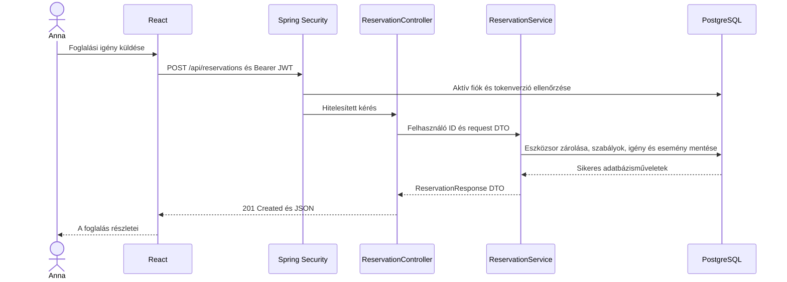

# EszközPont – védési kézikönyv az alapoktól

## Tartalom

1. [A projekt két mondatban](#1-a-projekt-két-mondatban)
2. [Indítás és a három folyamat](#2-indítás-és-a-három-folyamat)
3. [Technológiák és rétegek](#3-technológiák-és-rétegek)
4. [Egy gombnyomás útja](#4-egy-gombnyomás-útja)
5. [A nyolc üzleti tábla](#5-a-nyolc-üzleti-tábla)
6. [Jelszó, JWT és jogosultságok](#6-jelszó-jwt-és-jogosultságok)
7. [A foglalástól a visszavételig](#7-a-foglalástól-a-visszavételig)
8. [F12-es gyakorlat](#8-f12-es-gyakorlat)
9. [Tesztek, hibakeresés és csomagolás](#9-tesztek-hibakeresés-és-csomagolás)
10. [Védési kérdések válaszokkal](#10-védési-kérdések-válaszokkal)
11. [Gyakorlási sorrend](#11-gyakorlási-sorrend)

## 1. A projekt két mondatban

> Az EszközPont egy egyetemi eszköztár alkalmazása. A hallgató konkrét leltári eszközre igényt küld, az eszközfelelős dönt és rögzíti a fizikai átadást meg a visszavételt, az adminisztrátor pedig a felhasználókat és a törzsadatokat kezeli.

A bemutatóban egy kamerával érdemes végigmenni. Az igény Anna szándékát rögzíti. A jóváhagyás lefoglalja az időszakot. Az átadással jön létre a kölcsönzés, vagyis a tényleges használat nyilvántartása. Sérült visszavételnél a rendszer a kölcsönzés lezárásával együtt karbantartást indít. Utána az eseménytörténet megmutatja, ki mit végzett el és mikor.

**CRUD** a létrehozás, olvasás, módosítás és törlés angol nevéből áll össze. A kategóriakezelésen ezt kézzel is meg lehet mutatni. A foglalásnál az állapotot üzleti parancsok változtatják, például jóváhagyás vagy visszavonás. A kezelésükhöz időablak, szerepkör, tulajdonos, átfedés és párhuzamos mentés is számít. A leltári eszköz előzményei kivonás után is megmaradnak.

## 2. Indítás és a három folyamat

### Mi fut a gépen?

| Cím a helyi demóban | Mi figyel ezen a címen? |
| --- | --- |
| `http://127.0.0.1:5173` | A Vite fejlesztői szervere kiszolgálja a React alkalmazást. A React-kód a böngésződben fut. |
| `http://127.0.0.1:9090` | A Java alkalmazás HTTP-szervere fogadja az API-kéréseket. A helyi Swagger felülete a `/swagger-ui/index.html` címen érhető el. |
| `127.0.0.1:55432` | A helyi PostgreSQL adatbázis JDBC-n keresztül a Java alkalmazással kommunikál. |

A `127.0.0.1` a saját gép visszacsatolási címe. A port egy számozott hálózati végpont, így a három szolgáltatás egymás mellett tud futni. A böngésző a fejlesztői szerveren keresztül hívja az `/api` útvonalakat. A Vite továbbítja ezeket a backend 9090-es portjára. A Network fül emiatt mutathat 5173-as címet akkor is, amikor a választ a Java kód állította elő.

### Helyi indítás Windowson

A projekt gyökérmappájában nyiss PowerShellt. JDK 25 vagy újabb, Node.js 22.13 vagy újabb és a projektben rögzített pnpm 11.25.0 kell. A **JDK** tartalmazza a Java fordítóját és futtatókörnyezetét. A **Node.js** a frontend fejlesztői eszközeit futtatja, a **pnpm** telepíti és zárolt verziókkal kezeli azok függőségeit. A **Maven Wrapper** a projekthez tartozó indító a Java fordításhoz, teszteléshez és csomagoláshoz.

```powershell
# Első alkalommal a gyökérmappában
.\tools\run.ps1 -Task Install

# Első terminál
.\tools\run.ps1 -Task Backend

# Második terminál
.\tools\run.ps1 -Task Frontend
```

Várd meg a backend indulását. Nyisd meg a [helyi bejelentkezést](http://127.0.0.1:5173/belepes). Mindkét terminál fusson a bemutató alatt. A saját termináljukban a `Ctrl+C` megállítja őket.

| Demófiók | Szerepkör |
| --- | --- |
| `anna@eszkozpont.test` | Hallgató, `USER` |
| `bence@eszkozpont.test` | Második hallgató az adatvédelem és az átfedés bemutatásához |
| `kezelo@eszkozpont.test` | Eszközfelelős, `MANAGER` |
| `admin@eszkozpont.test` | Adminisztrátor, `ADMIN` |

A négy nyilvános, kizárólag helyi demófiók jelszava `EszkozPont2026!`. Az indító a helyi adatokat a `.local/postgres` könyvtárban tartja, és a Flyway induláskor alkalmazza a szükséges migrációkat. A `DemoData` az üres adatbázisba teszi be a fiókokat és az eszközöket. A tesztek külön ideiglenes adatbázisokat használnak. [Indítási útmutató](../README.md)

## 3. Technológiák és rétegek

### Mi az a Spring Boot?

A **Java** a backend nyelve. A **Spring** Java-keretrendszer, amely létrehozza és összeköti az alkalmazás komponenseit. A **Spring Boot** a Spring-alkalmazás indítását és alapbeállítását egyszerűsíti. Az EszközPont belépési pontja az `EszkozpontApplication.main`. A `SpringApplication.run` felépíti a komponenseket, indul a beágyazott HTTP-szerver, és a betöltött függőségekhez igazodva beáll a webes réteg és az adatbáziskapcsolat. A port, a kapcsolat és az alkalmazás egyéb beállításai YAML-ból és környezeti változókból jönnek. [Java belépési pont](../backend/src/main/java/hu/eszkozpont/EszkozpontApplication.java)

Az olyan jelölések, mint a `@Service` vagy a `@RestController`, **annotációk**. Egy-egy feladatot jeleznek a keretrendszernek. A Spring által kezelt példány neve **bean**. Amikor a `ReservationController` a konstruktorában egy `ReservationService` példányt kér, a Spring adja át neki. Ez a **függőséginjektálás**. Ugyanez miatt tudunk tesztben a valós idő helyére vezérelhető órát tenni.

| Név | Feladata az EszközPontban |
| --- | --- |
| Spring Web MVC | A HTTP útvonalat a megfelelő Java metódushoz rendeli. JSON-ból Java bemenetet készít, a válaszból JSON-t. |
| Spring Security | A controller előtt hitelesíti a kérést és ellenőrzi az útvonalhoz tartozó szerepkört. |
| Bean Validation | A request mezőszabályait ellenőrzi. A `@Valid` bekapcsolja azt a vezérlő bemenetén. A foglalási átfedés külön üzleti ellenőrzés. |
| Jakarta Persistence, röviden JPA | Szerződés arra, hogyan kapcsolódnak a Java entitások az adatbázistáblákhoz. |
| Hibernate | A JPA itt használt megvalósítása. Az entitásokat betölti, követi a változásukat, és SQL-ben írja vissza őket. |
| Spring Data JPA | Repository interfészekkel ad adatbázis-műveleteket. Szabályos metódusnévből egyszerű lekérdezést, összetettebb feladathoz megadott lekérdezést használ. |
| MapStruct | Fordításkor Java leképező osztályt generál. A `UserMapper` például `AppUser` entitásból `UserResponse`-t képez. |
| Flyway | Verziózott SQL-migrációkkal hozza létre és bővíti a sémát. Feljegyzi, melyik futott le. |
| PostgreSQL | Tárolja az adatokat. Idegen kulcsot, egyediséget, tranzakciót és sorzárat ad az üzleti szabályokhoz. |
| React és JavaScript | A felület komponensekből épül fel. Egy input értéke, a mentés állapota vagy az éppen bejelentkezett fiók új megjelenítést válthat ki. |
| React Router | A böngésző címe alapján választ oldalt. Az `App.jsx` adja meg a védett útvonalakat. |
| TanStack Query | Szerverről olvasott adatok ideiglenes gyorsítótára, betöltési és hibaállapot, újralekérés. Mentés után a szükséges lekérdezések érvényteleníthetők. |
| Vite és saját CSS | A Vite indítja a fejlesztői szervert és összeállítja a kiadható frontendfájlokat. A CSS szabályozza az elrendezést, színeket és mobilnézetet. |

### Miért több osztályban van egy funkció?

| Réteg | Mit csinál az igénylésnél? | Példa |
| --- | --- | --- |
| Controller | Fogadja a HTTP-kérést, kiveszi a JWT-ből a felhasználó ID-ját, és beállítja a HTTP-választ. | `ReservationController.create` |
| Service | Üzleti szabályokat hajt végre és tranzakciót határol. | `ReservationService.create` |
| Repository | Lekérdezést és mentést végez a PostgreSQL felé. | `ReservationRepository`, `EquipmentRepository` |
| Entity | Az adatbázisban tárolt rekord Java megfelelője, kapcsolatokkal együtt. | `Reservation`, `EquipmentItem` |
| DTO | Az API bemenetének vagy kimenetének explicit Java típusa. | `ReservationCreateRequest`, `ReservationResponse` |
| Mapper | Entitásból a kiadható mezők szerkezetét készíti el. | `ReservationMapper`, `UserMapper` |

A **moduláris monolit** egy telepíthető backendből áll, belül szerepük szerint csoportosított Java csomagokkal, például `auth`, `reservation`, `loan`, `maintenance`. Egy tranzakcióban menthető a visszavétel, a karbantartás és a napló. A frontend külön csomagolható. [Architektúra és adatmodell](architektura.md)

**Kódolvasási útvonal**. Keresd meg a backendben a `ReservationController` osztályt, majd ugorj a `service.create` hívásra. A frontendben kezdd a `ReservationForm.jsx`-nél. IntelliJ-ben a `Ctrl+B` a használt név deklarációjához visz. VS Code-ban a Go to Definition az alapbeállítás szerinti `F12`. A böngészőben az `F12` fejlesztői eszközöket nyit.

## 4. Egy gombnyomás útja

### URL, HTTP és JSON

Az **URL** egy cím. A **HTTP** szabályozza, hogy a kliens hogyan küld kérést, és a szerver hogyan válaszol. Egy kéréshez tartozik metódus, útvonal, opcionális lekérdezési paraméter, fejléc és esetenként törzs. A **REST API** itt egységes HTTP-felület a szerver adataihoz és üzleti műveleteihez. A **JSON** az adatok szöveges formátuma, amelyet JavaScript és Java is olvasni tud.

- `GET /api/equipment?q=canon&page=0` eszközöket olvas. A `q` és a `page` query paraméter. A szerver oldalszámozása nullától indul.
- `GET /api/reservations/42` a 42-es foglalást kéri le. A `42` útvonalparaméter. A szerver külön ellenőrzi a hozzáférést.
- `POST /api/reservations` új igényt hoz létre. A `POST /api/management/reservations/42/approve` azonosított foglalást hagy jóvá, üzleti parancsként.
- `PUT /api/me` menti a saját profil megjelenített nevét. Az admin `PATCH /api/admin/users/42` útvonala az adminisztrálható mezőkhöz tartozik, kötelező verzióval. A `DELETE` a már nem hivatkozott törzsadat végleges törlésénél jelenik meg.

### Így lesz a felületről adatbázisrekord



1. A `ReservationForm.jsx` összegyűjti az időpontot és a célt. A budapesti időpontokat a kliens UTC-pontokká alakítja.
2. Az `api()` segédfüggvény a böngésző `fetch()` függvényével elküldi a kérést. A `Content-Type: application/json` jelzi a törzs formátumát. Az `Authorization: Bearer …` viszi a tokent.
3. A Security hitelesítése után Spring MVC beolvassa a törzset a `ReservationCreateRequest` rekordba. Ez az eszköz, a kezdet, a vég és a cél mezőit tartalmazza. Az igénylő azonosítója a hitelesített JWT alanyából származik.
4. A service ellenőrzi az időtartamot, az eszköz állapotát és az ismert akadályokat. Az új igény `REQUESTED`, a mentés és az esemény a közös tranzakció része.
5. Az API küldi az állapotkódot, a választ és a `Location` fejlécet. A felület megnyitja az igény részleteit, és frissíti az érintett adatokat.

Két fontos Java annotáció együtt látható a controllerben. A `@RequestBody` a kérés törzsét köti a paraméterhez, a `@Valid` lefuttatja a deklarált mezővalidációt. A `@AuthenticationPrincipal` a Spring Security által hitelesített alanyt adja át. [Foglalás controller](../backend/src/main/java/hu/eszkozpont/reservation/ReservationController.java), [űrlap](../frontend/src/reservations/ReservationForm.jsx), [API-kliens](../frontend/src/api/client.js)

### Olvasd el ezt a rövid Java metódust

```java
@PostMapping("/reservations")
public ResponseEntity<ReservationResponse> create(@AuthenticationPrincipal Jwt jwt,
        @Valid @RequestBody ReservationCreateRequest request) {
    var response = service.create(Long.parseLong(jwt.getSubject()), request);
    return ResponseEntity.created(URI.create("/api/reservations/" + response.id())).body(response);
}
```

- A class szintű `@RequestMapping("/api")` és a metódus `@PostMapping("/reservations")` együtt adja a `POST /api/reservations` címet.
- A JWT alanya szöveg, a `Long.parseLong` Java számmá alakítja. Az igénylő ID-ját a service ettől a megbízható forrástól kapja. A requestben szereplő ID az **eszköz** azonosítója.
- A `ResponseEntity<ReservationResponse>` a válasz HTTP-kódját, fejléceit és DTO-ját hordozza. A `created()` állítja be a 201-et és az új rekord címét. A `body()` adja át a válasz tárgyát, amelyből a webes réteg JSON-t készít.

A Networkben egy ilyen **szemléltető** JSON-t látsz. A védéshez jövőbeli időszakot válassz az űrlapon. Ez a példa egy téli napon 10:00–12:00 budapesti időnek felel meg.

```json
{
  "equipmentId": 7,
  "startsAt": "2026-12-03T09:00:00Z",
  "endsAt": "2026-12-03T11:00:00Z",
  "purpose": "Interjúfelvétel az egyetemi projekthez."
}
```

A request validálása például a hiányzó kötelező mezőt és a cél hosszát vizsgálja. A service tudja megkérdezni az adatbázistól, hogy a 7-es eszköz most foglalható-e. Ugyanaz a kérés szerkezetileg érvényes lehet úgy is, hogy átfedés miatt 409-et kap.

| HTTP | Hogyan magyarázd el? | EszközPont-példa |
| --- | --- | --- |
| 200 | A művelet sikerült, van válasz. | Katalógus, saját profil, jóváhagyott foglalás válasza. |
| 201 | Új erőforrás jött létre. | Foglalási igény és a `Location: /api/reservations/{id}` fejléc. |
| 204 | A művelet sikerült, a válasz törzse üres. | Kijelentkezés, jelszócsere. |
| 400 | Hibás bemenet. | Túl rövid foglalás vagy hibás jelenlegi jelszó a jelszócsere űrlapján. |
| 401 | Hitelesítés hiányzik, érvénytelen vagy elutasított. | Hiányzó vagy visszavont JWT, hibás bejelentkezés. |
| 403 | Azonosított felhasználó tiltott műveletet kér. | Hallgató a kezelői végpontot hívja. |
| 404 | A keresett erőforrás ebben a hozzáférésben nem található. | Bence közvetlenül Anna foglalását kéri. |
| 409 | A művelet a jelenlegi állapottal ütközik. | Átfedés, elavult verzió, már átadott eszköz ismételt kiadása. |
| 500 | Váratlan szerverhiba. | A kliens magyar hibaüzenetet, a fejlesztő a szervernaplóban részleteket kap. |

A hibaválasz JSON-ja a `status` és `detail` mellett stabil `code` mezőt és mezőhibáknál `errors` tömböt ad. A `code` programból vizsgálható, a `detail` a felületnek szánt magyar szöveg. [Pontos API-szerződés](api-terv.md), [hibakezelő](../backend/src/main/java/hu/eszkozpont/common/ApiExceptionHandler.java)

## 5. A nyolc üzleti tábla

Egy **tábla** azonos szerkezetű rekordokat tartalmaz. Egy **sor** például egy konkrét kamerát jelent, az **oszlop** pedig egy adatát, például a nevét. Az **elsődleges kulcs** egyedileg megjelöli a sort. Az **idegen kulcs** egy létező másik sorra hivatkozik. Így az eszközben a kategória azonosítóját tároljuk, a kategória neve a saját táblájában szerepel.

| Tábla | Mit tárol? | Fontos kapcsolatok és korlátok |
| --- | --- | --- |
| `app_user` | Név, e-mail, jelszóhash, szerep, engedélyezettség, tokenverzió, rekordverzió. | Az e-mail egyedi és normalizált. Egy felhasználó több igény vagy esemény alanya lehet. |
| `equipment_category` | Kategórianév, leírás, aktív állapot, verzió. | Egy kategóriához sok eszköz tartozhat. A név normalizált összehasonlítással egyedi. |
| `storage_location` | Többek között helyszínkód, név, épület, helyiség, aktív állapot, verzió. | Egy helyszínhez sok eszköz tartozhat. A kód egyedi. |
| `equipment_item` | Fizikai példány egyedi leltári számmal, névvel, leírással és életciklussal. | Kötelező kategória és helyszín. Lehet aktív vagy kivont. |
| `reservation` | Igénylő, eszköz, tervezett időszak, cél, döntés, állapot és verzió. | Egy adott igény egy adott eszközre vonatkozik. A kezdet megelőzi a véget. |
| `loan` | Tényleges átadási és visszavételi idő, határidő, állapot, kezelők. | Egy igényhez legfeljebb egy kölcsönzés tartozik. Eszközönként legfeljebb egy nyitott kölcsönzés lehet. |
| `maintenance_period` | Tervezett karbantartási ablak, állapot, indok, rögzítő és lezárás. | Egy eszközhöz több karbantartás is lehet. A sérülési karbantartás a kölcsönzéshez is kapcsolódik. |
| `audit_event` | Művelet típusa, időpontja, eljáró és megjegyzés. | Eszközhöz vagy foglaláshoz kapcsolódik. Rendszereseménynél az eljáró lehet üres. |

**Kapcsolati példa**. Kategória → eszköz 1:N. Eszköz → foglalás 1:N. Foglalás → kölcsönzés 1:0..1. A Java `@ManyToOne` iránya például az eszköztől a kategóriára mutat. A szerepkör a fiók egy mezője, három megengedett értékkel. A Flyway sémaelőzmény-táblája technikai nyilvántartás.

**SQL-korlátok**. A `NOT NULL` kötelező értéket kér, a `UNIQUE` megakadályozza a duplikációt, a `CHECK` feltételt érvényesít. A nyitott kölcsönzések részleges egyedi indexe csak a `returned_at IS NULL` sorokat veszi figyelembe. A séma V1-ben jött létre, V2 adta a sérülési kapcsolatot, V3 a fiók szerkesztési verzióját, V4 a törzsadatok verzióit és normalizált egyediségét. A Flyway futtatja a migrációkat, a Hibernate `ddl-auto=validate` módban ellenőrzi az illeszkedést. [ER-diagram](architektura.md#kapcsolatok), [SQL-migrációk](../backend/src/main/resources/db/migration)

## 6. Jelszó, JWT és jogosultságok

### Négy különböző adat, amelyet könnyű összekeverni

| Adat | Hol van? | Mire való? |
| --- | --- | --- |
| A felhasználó jelszava | Beíráskor az űrlapban, majd az adott kérésben. | Regisztrációhoz, belépéshez és jelszócseréhez. |
| A jelszó BCrypt-hash-e | A szerver adatbázisában, az `app_user.password_hash` mezőben. | A szerver ezzel ellenőrzi a következő belépéskor megadott jelszót. |
| Access token | A belépési válaszban, majd a React memóriájában. A védett API-kérés fejlécébe kerül. | A szerver ebből és az adatbázis-ellenőrzésből tudja, kinek a nevében érkezett a kérés. |
| `JWT_SECRET` | Kizárólag a backend konfigurációjában. Helyi indításnál alapértelmezésben a Git által figyelmen kívül hagyott `.local/jwt-secret` adja. | A szerver ezzel hitelesíti az általa kiadott tokeneket. |

A PostgreSQL saját `DB_PASSWORD` értéke külön konfiguráció. Az a Java szerver adatbáziskapcsolatához tartozik. A demófiókkal a React felületre jelentkezel be.

### Regisztráció és BCrypt

1. A frontend a nevet, e-mailt és jelszót a `POST /api/auth/register` kérésben küldi.
2. A backend ellenőrzi a formátumot és a hosszt, a nevet körbevágja, az e-mailt kisbetűsíti. A role értékét az alkalmazás adja, az új fiók `USER`.
3. A BCrypt jelszóhash-t készít. A projekt `BCryptPasswordEncoder(12)` költségbeállítást használ. A BCrypt véletlen **sót** használ, amely a tárolt hash reprezentációjának része. Két egyforma jelszó külön létrehozott hash-e emiatt eltérhet.
4. Az adatbázisban a hash tárolódik. A `UserResponse` a fiók megjeleníthető mezőit tartalmazza. A publikus regisztráció sikeres válasza 201, majd a felület a belépésre irányít.

**Hash és titkosítás**. A titkosított adat megfelelő kulccsal visszafejthető. A BCrypt ellenőrzéskor a beírt értéket hasonlítja a tárolt hash-hez a só és a költség figyelembevételével. A tárolt hash-ből a programnak nem kell helyreállítania a jelszót. A költség lassítja a találgatást, így egy ellopott adatbázis esetén is számít a jelszó erőssége. A szerver új jelszóra 12–64 karaktert és legfeljebb 72 UTF-8 bájtot fogad. Az ékezetes vagy többbájtos karakter miatt a bájtok száma eltérhet a karakterekétől.

**Miért lehet a jelszó az F12-ben?** A böngésző küldi a beírt jelszót, így a saját böngésződ Network → Payload nézetében láthatod a kérés törzsét. A jelszómező pontjai a képernyős megjelenítést takarják. A tartós tárolást a BCrypt, a hálózati átvitelt éles környezetben a HTTPS védi. A helyi próba HTTP-n, loopback címen fut. A Networkben csak a dokumentált demófiók adataival gyakorolj, és a valódi jelszót vagy teljes tokent ne tedd képernyőképbe, megosztott naplóba vagy külső JWT-elemző oldalra. [Regisztráció és login service](../backend/src/main/java/hu/eszkozpont/auth/AuthService.java), [validáció](../backend/src/main/java/hu/eszkozpont/auth/RegisterRequest.java)

### Belépés és tokenkiadás

A `POST /api/auth/login` e-mailt és jelszót kap. Az `AuthService` lekéri a fiókot és a `passwords.matches` metódussal ellenőrzi a jelszót. Nem létező e-mail esetén is fut egy összehasonlítás egy előre elkészített segédhash-sel. A hiányzó fiók, rossz jelszó és letiltott fiók azonos nyilvános bejelentkezési hibát ad. Siker esetén a `JwtService.issue` létrehozza a tokent. A válaszban `accessToken`, `tokenType`, `expiresAt` és `user` érkezik. Az AuthContext eltárolja a választ, és az alkalmazás megnyitja az Áttekintést vagy az előzőleg kért védett oldalt.

**JWT** a JSON Web Token rövidítése. Ennél az aláírt változatnál a három, ponttal elválasztott rész a fejléc, a tartalom és az aláírás. A `Base64url` adatábrázolás, a fejléc és a tartalom olvasható. Az **aláírás** alapján ellenőrizhető, hogy a tokent a kulcsot ismerő szerver adta ki, és hogy a tartalom változatlan. Az EszközPont `HS256`-ot használ, vagyis HMAC-SHA-256-tal védi a tokent közös szerveroldali titkos kulccsal. A frontend átadja a tokent a backendnek, a kulcsot a backend használja.

| JWT mező | Mit jelent a projektben? |
| --- | --- |
| `alg` | A fejlécben az algoritmus, itt `HS256`. A dekóder ezt az algoritmust várja. |
| `sub` | A fiók adatbázis-azonosítója szövegként. |
| `iss`, `aud` | Kibocsátó és célközönség. Itt `eszkozpont` és `eszkozpont-web`. |
| `iat`, `nbf`, `exp` | Kiállítás, használhatóság kezdete és lejárat. A projekt alapértelmezett élettartama 30 perc. |
| `role` | Szerep a kiállításkor. Egyeznie kell a fiók aktuális szerepével. |
| `tokenVersion` | A fiók tokenjeinek verziója kiállításkor. Egyeznie kell a jelenlegi adatbázis-értékkel. |

### Mi történik minden védett kérésnél?

1. A kliens hozzáadja az `Authorization: Bearer …` fejlécet. A Bearer a bemutatott tokent használja hitelesítésre. Az érvényes token birtokosa a tokenhez tartozó hozzáféréssel kérhet adatot, ezért a token érzékeny.
2. A Spring Security ellenőrzi az aláírást és a token állításait. Az EszközPont ellenőrzi az adatbázisból a fiók létezését, engedélyezettségét, szerepét és tokenverzióját. A Spring Security ebből képez `ROLE_USER`, `ROLE_MANAGER` vagy `ROLE_ADMIN` jogosultságot.
3. A biztonsági szabály az `/api/management/**` végpontot kezelőnek és adminnak, az `/api/admin/**` útvonalat adminnak engedi. Az API belépést kér a többi védett végpontra.
4. Az adott funkció service-e az erőforrás szintjén vizsgálja a jogot. Egy hallgató hiteles tokenje elég a saját foglalásához. Más hallgató rekordjára 404-et kap. A felület menüje és útvonalvédelme a használatot segíti, a jogosultságot a szerver kényszeríti ki.

**Hitelesítés** azt mondja meg, ki küldte a kérést. **Jogosultságkezelés** azt dönti el, mit tehet. **RBAC** a szerepkör alapján elérhető műveletek modellje. **Tulajdonosi ellenőrzés** azt vizsgálja, hogy a konkrét rekord az adott fiókhoz tartozik-e. Az elbírálásnál további üzleti szabály, hogy a kezelő a saját igényét nem hagyhatja jóvá. [Biztonsági beállítások](../backend/src/main/java/hu/eszkozpont/auth/SecurityConfig.java), [tokenkiadás](../backend/src/main/java/hu/eszkozpont/auth/JwtService.java)

### A munkamenet vége, a jelszócsere és a kétféle verzió

- **Lejárat.** A React időzítője a token lejáratakor lezárja a helyi munkamenetet. Ha a szerver előbb 401-et ad egy tokenes kérésre, a kliens szintén visszavisz a belépéshez, és törli a lekérdezési gyorsítótárat.
- **Böngészőfrissítés.** A JWT az AuthContext állapotában él. Teljes újratöltéskor ez újraindul, és új belépés kell. Másik frissen megnyitott böngészőfül külön munkamenettel indul. A projekt ebben a változatban nem ad megújító tokent.
- **Szerveroldali kijelentkezés.** A `POST /api/auth/logout` növeli a fiók tokenverzióját. Például az adatbázis 3-ról 4-re vált, a korábbi 3-as token már nem megy át az ellenőrzésen. 204 után a frontend saját állapotát és gyorsítótárát is törli. Ugyanennek a fióknak másik fülön kiadott JWT-je is érvényét veszti.
- **Jelszócsere.** A `Fiókom` az új jelszó ismétlését kliensoldalon ellenőrzi. A backend a jelenlegi jelszót ellenőrzi, új hash-t készít, és egy tranzakcióban növeli a tokenverziót. A módosítás felhasználói sorzár után újra ellenőrzi az aktív fiókot és a verziót. Siker esetén minden korábbi hozzáférés lejár. A helyes új jelszóval új JWT kérhető.
- **Névmódosítás.** A saját `PUT /api/me` az aktuális fiók megjelenített nevét menti. A frontend a válasz alapján frissíti a nevet, és a JWT megmarad. Az admin személyi adatokat kezelő végpontja eltérő művelet. Tényleges adminmódosításkor a célfiók tokenjeit visszavonja.
- **`version` és `tokenVersion`.** A rekordverzió szerkesztési ütközésekhez kell, például a kezelő elavult foglalásadatlapját jelzi. A tokenverzió a hozzáférés visszavonásához kell. Mindkettő szám, eltérő szabállyal.

**Mi a CORS és miért van CSRF-kikapcsolás?** A CORS azt szabályozza, hogy a böngésző mely eltérő originről engedheti az API használatát. Origin a séma, gépnév és port együtt, ezért a `localhost` és a `127.0.0.1` két külön név. A helyi Vite proxy saját originen keresztül küldi a böngészős kéréseket. A külön originnel közvetlenül kért API-hoz pontos engedélylista tartozik. A szerver az autentikációhoz explicit Bearer fejlécet használ, a böngésző nem csatol magától hitelesítő session cookie-t keresztoldali kéréshez. Ezért a projekt ehhez a felépítéshez nem használ CSRF-tokent. A CORS-tól függetlenül a szerver minden védett kérésnél hitelesít. A memóriában lévő JWT-hez ugyanazon oldal kódja hozzáférhet, ezért egy XSS-hibát ez a döntés önmagában nem old meg. [Frontend hitelesítési állapot](../frontend/src/auth/AuthContext.jsx), [szerverkonfiguráció](../backend/src/main/resources/application.yml), [helyi konfiguráció](../backend/src/main/resources/application-local.yml)

### Ha meg kell mutatnod, hol van ez a kódban

| Mit keress? | Mit magyarázz közben? |
| --- | --- |
| `BCryptPasswordEncoder(12)` a `SecurityConfig`-ban | Ez a Spring által létrehozott jelszókezelő bean. Az `AuthService` konstruktoron keresztül kapja meg, és az `encode` vagy a `matches` metódust hívja. |
| `JwtClaimsSet.builder()` a `JwtService`-ben | Itt épül fel az aláírt tartalom a fiókból és az órából. A JWT-hez tartozó e-mail és név a belépési válasz külön `user` mezőjében olvasható. |
| `jwtDecoder` és `filterChain` a `SecurityConfig`-ban | A dekóderhez tartozik az aláírás és az állítások ellenőrzése, a szűrőlánchoz az URL-ek szerepkörszabálya és a JSON hibaválasz. |
| `invalidateTokens` a `UserRepository`-ban | A kijelentkezés adatbázis-frissítése egyszerre növeli a tokenverziót és a szerkesztési verziót. |
| `setSession(result)` az `AuthContext.jsx`-ben | A belépési eredmény React-állapotba kerül. Az `api()` a kapott tokenből állítja össze az Authorization fejlécet, közvetlen tárolóírás nélkül. |

## 7. A foglalástól a visszavételig

### Állapotok és jogosult műveletek

| Kiindulás | Művelet | Mi változik? |
| --- | --- | --- |
| Szabadnak látszó aktív eszköz | A bejelentkezett felhasználó érvényes időszakra küld igényt. | Új `REQUESTED` foglalás, eseménnyel. Az időszakot még nem foglalja le. |
| `REQUESTED` | Kezelő még a kezdés előtt jóváhagyja, ha a feltételek fennállnak. | `APPROVED`, a naptárban foglalt időszak. Kezelő sajátját nem hagyhatja jóvá. |
| `REQUESTED` | Kezelő indokot ad és elutasítja. | `REJECTED`. |
| `REQUESTED` vagy `APPROVED` | Jogosult személy átadás előtt visszavonja. | `CANCELLED`. A tulajdonos a kezdés előtt teheti meg. Kezelő másét indokkal vonhatja vissza. |
| `APPROVED` érvényes átadási ablakban | Kezelő kiadja az eszközt jó vagy használt állapotban. | Megnyílik a `Loan`, a foglalás `APPROVED` marad. A képernyőn a kölcsönzés állapota **Átadva**. |
| Nyitott kölcsönzés | Kezelő visszaveszi az eszközt. | Visszavételi idő, kezelő és állapot kerül a rekordba, a foglalás `COMPLETED`. Sérüléskor `OPEN` karbantartás is létrejön. |
| Át nem vett `REQUESTED` vagy `APPROVED`, véget ért időszak | A háttérfolyamat feldolgozza. | `EXPIRED`, rendszeresemény. |

**Időszak**. Az új igény kezdete jövőbeli, legfeljebb 60 nappal előre, a hossza 1 óra–14 nap. Az időpontokat egész percre kell megadni, a cél hossza 1–500 karakter. A `datetime-local` mező szövegében nincs időzóna, ezért a projekt explicit budapesti zónából képez időpillanatot. Az óraátállításkor hiányzó vagy kétszer előforduló percekre másik bevitelt kér. A backend `Instant`-ot fogad offsetes ISO-dátumból, a felület budapesti időben jeleníti meg a választ.

**Átfedés**. Az ablak `[kezdet, vég)`, vagyis a vége már a következő időszakhoz tartozhat. Két ablak átfed, ha `A.kezdete < B.vége && A.vége > B.kezdete`. A 10:00–11:00 és a 11:00–12:00 engedélyezett egymás mellett. A 10:00–11:00 és 10:30–11:30 ütközik. Két függő igény átfedhet, mert egyik sem biztosítja még az eszközt. Amikor egyikük jóváhagyott lesz, az átfedő második már nem hagyható jóvá.

### Tranzakció, zár és verzió ugyanabban a példában

Tegyük fel, hogy két eszközfelelős egyszerre hagy jóvá két átfedő kérelmet ugyanarra a kamerára. Mindkettőnek látszhatott szabadnak a kamera. Ha a mentés előtti ellenőrzés egymástól függetlenül futna, mindketten szabadnak találhatnák az eszközt.

1. Az első művelet megszerzi az adott kamera PostgreSQL-sorzárát. A második erre a sorra vár.
2. Az első a záron belül ellenőrzi az állapotot és az átfedést, majd elmenti a jóváhagyást és az eseményt. A tranzakció lezárásával felszabadul a zár.
3. A második a zár megszerzése után olvassa a foglalást, és az új jóváhagyást már látja. Az átfedés miatt 409-es hibát ad. Másik kamera művelete ettől a sortól függetlenül futhat.
4. Ha ugyanazt az igényt szerkesztenék egy régi képernyőről, a request `version` mezője is számít. Ez foglalásonként működik, ezért két külön foglalás átfedésének vizsgálatához kell az eszközsorzár.

**Tranzakció** egy közösen véglegesített adatbázis-műveletcsoport. Ha a jóváhagyás után az esemény mentése hibás, az üzleti mentés is visszagördül. Sérült visszavételnél így marad együtt a kölcsönzés lezárása, a foglalás állapota, a karbantartás és a napló. Az **audit esemény** a projektben adatbázisban tárolt üzleti tény. A szerver technikai logja a fejlesztői hibakereséshez külön szolgál. [Foglalási service](../backend/src/main/java/hu/eszkozpont/reservation/ReservationService.java), [kölcsönzési service](../backend/src/main/java/hu/eszkozpont/loan/LoanService.java)

### Amit a naptár, a kezelői lista és a dashboard mutat

- **Katalógus és naptár.** Az aktív állapot azt jelenti, hogy az eszköz az állományban elérhető. Az időszakos elérhetőséget az ütközési adatokból számoljuk. A PostgreSQL a szűrést a lapozás előtt végzi. A heti naptár a jóváhagyott foglalásokat és nyitott karbantartásokat időszakként adja vissza, név és cél nélkül. Éjfélen átnyúló intervallum a felületen két napra oszlik. Mindkét nézet pillanatkép, az írás újraellenőriz.
- **Átadás, késés és karbantartás.** Az átadás a foglalási ablak kezdetétől a vége előtt lehetséges. Az aktuális körülményeket is ellenőrzi, például korábbi nyitott kölcsönzést és karbantartást. Az átvett eszköz akkor késik, ha a határidő elmúlt és még kint van. A pontos határidő még határidőn belüli. A lezárt rekord késését a tényleges visszavételi időponthoz mérjük. A sérült eszköz karbantartási zárolását az eszközfelelős zárja le. A tervezett befejezés elmúlta után a még nyitott javítás továbbra is blokkolhat. Érintett jóváhagyott foglalás figyelmeztetést kap, az állapota ettől még megmarad.
- **Automatikus lejárat.** Az alapértelmezett egyperces késleltetésű Spring ütemező egy futásban legfeljebb 100 jelöltet vesz át. Feldolgozáskor friss állapotot ellenőriz. A lejárt kölcsönzött eszközt fizikailag az eszközfelelős veszi vissza.
- **Dashboard.** A hallgatói végpont a JWT szerinti fiók teendőit és számait adja. A kezelői áttekintés a jövőbeli függő igényeket, mai átadásra váró és ma visszahozandó eszközöket, késéseket és nyitott javításokat számolja. A 30 naptári napos, kategóriánkénti grafikon tényleges átadásokból készül. A leadott kölcsönzés átadása is beleszámít. A budapesti naphatárokat és a darabszámokat a backend számolja, a frontend megjeleníti.
- **Adminisztráció.** Az admin fiókot tilthat, szerepet változtathat, kategóriát és tárolási helyet kezelhet. Az utolsó aktív admint nem lehet letiltani vagy lefokozni. A felhasználó-adminisztráció ellenőrzését közös PostgreSQL tranzakciós zár védi. Élő igény vagy nyitott kölcsönzés megakadályozhatja a törzsadat archiválását. A hivatkozott törzsadat végleges törlését a kapcsolat védi. Az archiválás visszafordítható, az eszköz kivonása megőrzi a leltári és foglalási múltat.

[Foglaltság és katalógus](naptar-es-idoszakszures.md), [átadás, visszavétel és késés](harmadik-fejlesztesi-egyseg.md), [törzsadat és lejárat](torzsadatok-es-lejarat.md), [dashboard API](api-terv.md#áttekintés)

## 8. F12-es gyakorlat

### Mit látsz az egyes füleken?

| Fül | Mire jó a védésen? |
| --- | --- |
| **Elements / Elemek** | A böngészőben megjelenő HTML-szerkezetet, a DOM-ot és a CSS-szabályokat mutatja. Egy elemre kattintva látható a mérete, margója és melyik szabály adja a stílust. A helyi változtatás újratöltéskor elvész. |
| **Network / Hálózat** | A kérések sorrendje, URL-je, metódusa, fejlécei, törzse, válasza és időigénye. A védésen ezt használd a legtöbbet. |
| **Application / Alkalmazás** | Az adott origin böngészőtárai, köztük Local Storage, Session Storage és Cookies. Ezekben az EszközPont JWT-je nem szerepel. Az AuthContext JavaScript-memóriája külön dolog. |
| **Console / Konzol** | Böngészős JavaScript-hibák és kézzel futtatott JavaScript. A Spring szerver naplója a backend termináljában jelenik meg. |
| **Sources / Források** | A böngésző által betöltött forrásfájlok és töréspontok. A Java service kódját az IDE-ben olvasd. |
| **Eszköztár mód** | A keskeny nézetet szimulálja. Próbáld ki 390 px szélességen az oldalsávot, katalógust, adatlapot és időmezőket. |

### A. Mutass meg egy belépést

1. Indítsd a két helyi szolgáltatást. Nyisd meg Chrome-ban vagy Edge-ben a `http://127.0.0.1:5173/belepes` oldalt. Nyomj `F12`-t vagy `Ctrl+Shift+I`-t.
2. Kattints a **Network** fülre, válaszd a **Fetch/XHR** szűrőt és ürítsd a lista előzményeit a Clear gombbal. Ha teljes navigáció után is látni szeretnéd a kéréseket, kapcsold be a **Preserve log** opciót.
3. Lépj be Annával a helyi demóba. Keresd meg a `login` sort. A **Headers** részben nézd meg a `POST` metódust, az `/api/auth/login` útvonalat és a `200` választ. Ekkor még nincs szükség Bearer tokenre.
4. A **Payload** fülön a böngésző által elküldött `email` és `password` mezőt látod. A **Preview** vagy **Response** alatt a sikeres válasz `user`, `expiresAt`, `tokenType` és `accessToken` mezőit magyarázd el. A tanárnak a mezőneveket és a szerkezetet mutasd. A teljes token kitakarható vagy összecsukható.
5. Nyisd meg az utána érkező `dashboard/me` kérést. A **Headers → Request Headers** alatt már van `Authorization: Bearer …`. A válasz a függő igények és aktív kölcsönzések számát, valamint a következő teendőket adja. Nincs jelszó vagy hash a válaszban.

> „A belépési kérésben a jelszó van. A sikeres belépés válaszában kapott JWT-t a következő kérés már a fejlécben viszi. A szerver ellenőrzi a tokent, mielőtt kiadná a saját dashboard adatait.”

### B. Mutass meg egy üzleti kérést

1. Nyisd meg a katalógust, keress az eszköz nevére vagy leltári számára. A `GET /api/equipment` sorban a **Query String Parameters** mutatja a keresést és a lapozást. A JSON válasz `content` tömbjében eszközök, a `page` mezőben a lapozás adatai jelennek meg.
2. Nyiss egy aktív eszközt. Adj meg szabad, jövőbeli, legalább egyórás időablakot és megfelelő hosszú célt. A foglalás beküldésekor a `POST /api/reservations` kérést nyisd meg.
3. A **Payload** alatt `equipmentId`, `startsAt`, `endsAt`, `purpose` látszik. A válasz `201`, a **Response Headers** között `Location`, a **Response** alatt a rekord azonosítója és `REQUESTED` állapota olvasható. A regisztrációtól kapott `user.id` és a foglalás saját `id`-ja két külön dolog.
4. Külön fülön jelentkezz be a kezelővel. Az igény jóváhagyásakor figyeld a `POST …/{id}/approve` kérést. A törzs `version` mezője az olvasott rekordváltozat. A kezelői felület elvégzi az újralekérést, ezért egy művelet után több GET is megjelenhet a Network listán.
5. Az ütközéshez ugyanarra az eszközre még az első jóváhagyás előtt legyen két, egymást átfedő függő igény. Az első jóváhagyás után a másodikra várható `409` és `RESERVATION_CONFLICT`. A pontos menetrend és az előre időzített átadás külön le van írva. [Élő forgatókönyv](vedesi-forgatokonyv.md)

### C. Mutasd meg a három védelmi szintet

**401, amikor nincs token.** A helyi alkalmazás böngészőfülén, a **Console**-ban a következő rövid, csak olvasó példát futtasd. Az URL ugyanazon helyi oldalon marad. A natív `fetch` itt nincs összekötve az alkalmazás AuthContextjével, ezért a kéréshez külön megadott token híján nem lesz Bearer fejléc.

```js
const response = await fetch("/api/me");
console.log(response.status, (await response.json()).code);
// Várt eredmény a helyi EszközPontban: 401 UNAUTHORIZED
```

**403, amikor a szerep kevés.** A React útvonalvédelme miatt a hallgató az adminfelület címén előbb a kliens magyar hozzáférési oldalát láthatja. Ott akár el is maradhat az admin API-hívás. A szerver külön ellenőrzését a `rolesAreEnforcedOnTheBackend` integrációs tesztben mutasd meg. A teszt valódi belépési JWT-vel hívja a védett végpontokat és ellenőrzi a 403-at.

**404, amikor másé a rekord.** Jegyezd meg Anna meglévő foglalásának azonosítóját. Külön fülön Benceként nyisd meg a `/foglalasok/<Anna foglalásának azonosítója>` felületi címet. Ha közvetlen navigáció miatt belépést kér, jelentkezz be Bencével. A Networkben a `GET /api/reservations/{id}` 404-et ad. Anna ugyanerre a saját fiókjából 200-at kap. Ezzel a tulajdonosi ellenőrzést mutatod meg.

### D. Mutasd be a visszavonást tokenmásolás nélkül

1. Lépj be ugyanazzal a helyi demófiókkal két külön fülön.
2. Az első fülön a Network megnyitása után kattints a **Kijelentkezés** gombra. A `POST /api/auth/logout` válasza 204.
3. A második fülön kérj friss szerveradatot. Ha már visszairányított a login oldalra, a Networkben keresd meg az odavezető 401-et. Egy fókuszváltás vagy háttérben futó újralekérés már kiválthatta.
4. Magyarázd el, hogy mindkét token a fiók régi tokenverzióját tartalmazta. Másik fiók munkamenetét ez nem érinti. A sima böngészőfrissítés külön eset, az csak a fül memóriáját törli.

### E. Swagger és a forráskód

A helyi Swagger megmutatja a backend útvonalait, sémáit és metódusait. A **Try it out / Execute** gomb valódi API-hívást küld a helyi backendnek. A Swagger-leírás jelenléte önmagában nem enged hozzáférést egy végponthoz. A forrásban a tényleges szerepkörszabályt a `SecurityConfig.filterChain`, az ellenőrzését a `FoundationIntegrationTest.rolesAreEnforcedOnTheBackend` alatt találod. [Helyi Swagger](http://127.0.0.1:9090/swagger-ui/index.html), [backend jogosultsági tesztek](../backend/src/test/java/hu/eszkozpont/FoundationIntegrationTest.java)

### Amit gyakran félreértenek F12-ben

- A `/foglalasok/42` a React oldal címe, a `/api/reservations/42` az API-végpont. A Network Fetch/XHR szűrőjében az utóbbit keresd.
- Az `Authorization` a **Request Headers** alatt van. Az `accessToken` mező a belépés **Response** részében érkezik. A login kérés **Payload** részében e-mail és jelszó van.
- A 204 melletti üres Response sikeres, tartalom nélküli választ jelent.
- A Console által jelzett várt 401, 404 vagy 409 hasznos a bemutatóban. A status kód mellé nézd meg a részletező JSON-t.
- Az Elements fülön átírt szöveg a böngésző saját nézetét érinti. Frissítés után az oldal ismét a szerver adatait hozza.
- A Network **Timing** összidejéből önmagában nem olvasható ki egy SQL-lekérdezés ideje. A böngésző az egész HTTP-kérés életútját méri.

## 9. Tesztek, hibakeresés és csomagolás

| Ellenőrzés | Mit mutat meg? |
| --- | --- |
| Unit teszt | Kisebb egységet ellenőriz önállóan. A `ReservationExpiryJobTest` például azt vizsgálja, hogy egy hibás feldolgozás után a következő rekordra is sor kerül. |
| Backend integrációs teszt | Spring alkalmazáskontextust és valódi, ideiglenes PostgreSQL-t indít. A MockMvc a webes réteget, Securityt, service-t és adattárolást együtt ellenőrzi. A token a valódi belépési végpontról származik. |
| Frontend teszt | A Vitest és a Testing Library felhasználói műveleteket és reakciókat vizsgál. A mockolt HTTP-válasz reprodukálható hibát vagy sikert ad. |
| Kézi böngészőpróba | A futó frontend és backend együtt látszik. A valódi kattintások, visszajelzések és szerepkörök ellenőrizhetők. |

**Három teszt, amit érdemes megnyitni a védésen**

1. `passwordChangeChecksTheCurrentPasswordAndRevokesAllPreviousSessions` a `FoundationIntegrationTest` osztályban. Rossz jelenlegi jelszó és hibás új jelszó elutasítása, siker után korábbi JWT-k elutasítása, régi jelszó elutasítása, új jelszóval siker, másik fiók megőrzött hozzáférése.
2. `simultaneousOverlappingApprovalsHaveExactlyOneWinner` a `ReservationIntegrationTest` osztályban. Két tényleges kérés ugyanarra az eszközre. A teszt ellenőrzi a zárvárakozást, majd az egy sikeres és egy 409-es választ.
3. `auditFailureRollsBackTheDecisionAsWell` ugyanott. A teszt adatbázishibát idéz elő az auditbejegyzésnél, és ellenőrzi, hogy a foglalás döntése is visszagördült.

A dokumentált beadási futtatáson 131 backendteszt és 64 frontendteszt ment át. A tesztszám egy adott futtatási állapothoz tartozik. A teljes build egy futtatható Spring Boot JAR-t és a frontend `dist` könyvtárát állítja elő.

```powershell
.\tools\run.ps1 -Task Test
.\tools\run.ps1 -Task Build
```

**Ha élőben hiba van**, menj a Networkbe és kövesd a kérést. Ha nincs HTTP-válasz vagy a proxy 5xx-et ad, ellenőrizd a két terminált és a portokat. Ha 401-et látsz, nézd meg, hogy nyilvános vagy védett kérést figyelsz, és van-e aktív belépés. A 403-at szerepkörrel, a 404-et azonosítóval és tulajdonossal, a 409-et az aktuális adatokkal és üzleti feltételekkel magyarázd. Ha a Vite port foglalt, nézd meg, fut-e már egy másik példány. Ha induláskor a PostgreSQL vagy a Flyway jelez hibát, a backend termináljában lesz a részletező üzenet.

**Helyi demó és kiadható csomag**. A helyi indító natív PostgreSQL-t és demófiókokat használ, a kiadható JAR normál PostgreSQL-kapcsolatot vár. A frontend statikus fájljainak kiszolgálásáról és az `/api` útvonal továbbításáról a telepítési környezetnek kell gondoskodnia. Az alkalmazás éles futtatásához megfelelő titokkezelés, adatbázis-hitelesítés és HTTPS szükséges. A dokumentált beadási ellenőrzés Windows alatt készült. [Ellenőrzési jegyzőkönyv](ellenorzes.md), [kiadható build és konfiguráció](../README.md)

## 10. Védési kérdések válaszokkal

A második oszlopban szóban is elmondható válaszok vannak. Gyakorold úgy, hogy a válasz után konkrét képernyőt vagy osztályt meg tudsz nyitni.

### Technológia és felépítés

| Kérdés | Rövid válasz |
| --- | --- |
| Mi az a Spring Boot? | A Springre épülő keretrendszer, amely elindítja és alapértelmezésekkel konfigurálja a Java alkalmazást. Itt a `main` az `EszkozpontApplication` osztályban van. |
| Hol fut a React és hol fut a Java? | A React a böngészőben. A Java szerver a saját folyamatában fogad HTTP-kéréseket és kapcsolódik az adatbázishoz. |
| Mi a különbség Spring és Spring Boot között? | A Spring kezeli és összeköti a komponenseket. A Boot az indítás és az automatikus konfiguráció kényelmi rétegét adja hozzá. |
| Mire kell a controller, service, repository? | A controller a HTTP szerződést kezeli, a service végzi az üzleti döntést, a repository adatot olvas vagy ment. |
| Mi a JPA, és mi a Hibernate? | A JPA a Java adatbázis-leképezési szerződés, a Hibernate a tényleges megvalósítás. |
| Miért DTO-t küldesz? | Az API konkrét mezőket ígér. Például az entitás jelszóhash-t tartalmaz, a `UserResponse` csak azonosítót, nevet, e-mailt és szerepet. |
| Hol látszik a MapStruct munkája? | A `UserMapper` interfésznek fordításkor elkészül a Java implementációja. A szerver ezt hívja a válasz elkészítéséhez. Fordítás után az implementáció a Maven által generált források között megnézhető. |
| Miért PostgreSQL? | A futtatásnál és tesztelésnél ugyanaz az adatbázismotor biztosítja a sorzárat és a konzisztenciát. A projekt PostgreSQL-specifikus részleges egyedi indexet és tranzakciós zárat is használ. |
| Mire jó a Flyway? | Verziókövetett SQL-sémát épít, így egy új telepítés és egy régebbi adatbázis is alkalmazhatja a rá váró migrációkat. |
| Miben más a pnpm és a Maven? | A pnpm a frontend JavaScript-függőségeit és szkriptjeit kezeli, a Maven a Java fordítást, függőségeket, teszteket és csomagolást. |
| Mi történik, ha a HTML-t átírod az Elementsben? | A DOM helyi megjelenítése változik. HTTP-kérés és szerveroldali mentés csak akkor történik, ha az alkalmazás művelete elindítja. |
| Hogyan újul meg a lista mentés után? | A TanStack Query érintett kulcsait a frontend érvényteleníti. Új GET kérést indíthat, így az új állapot szerverről érkezik. |

### Jelszó és token

| Kérdés | Rövid válasz |
| --- | --- |
| Hol van a jelszó? | Beíráskor a böngésző ismeri, a belépésnél elküldi. Az adatbázisban BCrypt-hash van. A válasz DTO-ban nincs jelszómező. |
| Hogyan ellenőrzöd a BCrypt-hash-t? | A `PasswordEncoder.matches` az éppen beírt jelszót és a tárolt hash-t kapja. A tárolt formátum a sót és a költséget is hordozza. |
| Miért 72 bájt? | A BCrypt bemeneti korlátja miatt a szerver külön vizsgálja az UTF-8 méretet. A karakterhossz ellenőrzése mellett erre is szükség van. |
| Mi van a tokenben? | Azonosító, szerep, tokenverzió és időadatok, valamint kibocsátó és célközönség. Ezek aláírva utaznak. |
| Ha a JWT tartalma olvasható, mi védi? | A tartalma olvasható Base64url formában. Az aláírás hitelesíti az eredetet és a sértetlenséget. Az API a tokent csak sikeres ellenőrzés után fogadja el. |
| Miért teszed az Authorization fejlécbe? | A bejelentkezett API-kérések ezt a szabványos Bearer fejlécet használják. A jelszót csak a fiókhitelesítéshez szükséges műveletek küldik. |
| Hol tárolódik a token F12-ben? | A React AuthContext memóriájában él. A hálózati kérésekben megjelenik, a böngésző tartós táraiban nem. |
| Miért nincs belépés újratöltés után? | A böngésző újra létrehozza a React alkalmazást, elveszik a memóriában levő token. Kijelentkezéskor emellett a szerver is visszavonja az előző tokeneket. |
| Hogy működik a kijelentkezés, ha a JWT önállóan ellenőrizhető? | A szerver a token verzióját összeveti a fiók aktuális értékével. Kijelentkezéskor növeli az adatbázisban lévő számot. Ezzel az aláírás még ép lehet, de a hozzáférés már érvénytelen. |
| Mi van, ha jelszócsere közben két kérés érkezik? | A felhasználói sorzár sorrendbe állítja az írásokat. Zár után újra ellenőrizzük a tokenverziót. Egy sikeres csere után a régi tokenű várakozó kérés elutasítható. |
| Mi a felület és a backend feladata a jogoknál? | A React szerepkör szerint mutat menüt és oldalakat. A Security a kérés útvonalán ellenőrzi a szerepet, a service a konkrét rekordhoz és művelethez tartozó jogot. |
| 401, 403 és 404 között mi a különbség? | 401-nél nincs elfogadott hitelesítés. 403-nál a szerep vagy szabály tiltja a kérést. Az idegen foglalásra adott 404 elrejti a rekord létezését is. |
| Mi történik, ha ellopnak egy érvényes Bearer tokent? | Felhasználható lehet az adott fiók nevében lejáratig vagy visszavonásig. Ezért kell védeni a tokent, és éles hálózaton HTTPS-t használni. |
| A CORS önmagában megvéd? | A CORS a böngésző külön originről indított kéréseit szabályozza. A hozzáférést a szerver hitelesítési és jogosultsági szabályai ellenőrzik. |

### Üzleti logika

| Kérdés | Rövid válasz |
| --- | --- |
| Mi a különbség igény, jóváhagyott foglalás és kölcsönzés között? | Az igény kérés. A jóváhagyás fenntartja az időablakot. A kölcsönzés tényleges átadáskor keletkezik, külön idő- és állapotadatokkal. |
| Miért fér el két azonos függő igény? | Az eszközfelelősnek kell eldöntenie, ki kapja az eszközt. Jóváhagyáskor a másik kérés újraellenőrzésen megy át. |
| Miért használod külön a sorzárat és a verziót? | A sorzár az azonos eszközre vonatkozó párhuzamos műveleteket védi. A verzió ugyanazon rekord elavult szerkesztését jelzi. |
| Mi van, ha pontosan egymás végén indul két időszak? | Az intervallum vége kizárt, ezért a 10–11 és 11–12 egymás mellé fér. Átadáskor ezen túl a ténylegesen még nyitott kölcsönzést is ellenőrzi a rendszer. |
| Miért kell UTC és budapesti idő? | A budapesti zóna az emberi bevitelhez és megjelenítéshez kell. Az Instant egyértelmű időpillanatot ad a tároláshoz és összehasonlításhoz. |
| Mi történik, ha jóváhagyás után meghibásodik az eszköz? | A sérült visszavétel lezárja a kölcsönzést és zárolást hoz létre. A későbbi jóváhagyás megmaradhat, figyelmeztetést kap, és az átadáskor ismét futnak a biztonsági ellenőrzések. |
| Miért marad kint a késő eszköz? | A határidő az elvárt visszahozás. A kint lévő eszköz tényleges visszavételét kell rögzíteni. |
| Mi kerül a naptár válaszába? | Az akadály típusa, időszaka és az eszköz foglalhatóságához szükséges jelzések. A név és az igény célja a hozzáférésvédett foglalási adatlapon marad. |
| Mit számol a grafikon? | Kategóriánként a legutóbbi 30 budapesti naptári nap tényleges átadásait. A visszavett kölcsönzés átadása is része az összesítésnek. |
| Mitől több a projekt egy katalógusnál? | A döntés, a fizikai kiadás, a sérülési zárolás, a visszavétel és az eseménytörténet ugyanahhoz az eszközhöz kapcsolódik. A párhuzamos igényeket és állapotátmeneteket a szerver kezeli. |
| Milyen korlátot tudsz megnevezni? | A jelenlegi változat kézi átvétellel, egy intézményre működik. A JWT-t újratöltés után új bejelentkezéssel kapom vissza. A védéses futtatás helyi PostgreSQL-lel történt. |

## 11. Gyakorlási sorrend

### 15 perc, ha közel a védés

1. Mondd el kívülről a projekt két mondatát, majd sorold fel a három szerepkört.
2. A Networkben mutasd meg egymás mellett a `login` kérés törzsét és a `dashboard/me` Authorization fejlécét.
3. Mondd el a különbséget a jelszó, a hash, a token és a token aláírókulcsa között.
4. Magyarázd el a 401, 403, 404 és 409 egy-egy példáját. Figyeld meg a Network státuszt és a válasz szövegét.
5. Mutasd be a foglalás → átadás → visszavétel sorrendet az eseménytörténetből.

### 60–90 perc, ha végig tudod próbálni

1. Indítsd el a szolgáltatásokat a README alapján. Lépj be mindhárom szerepkörrel külön füleken.
2. Kövesd a [védési forgatókönyvet](vedesi-forgatokonyv.md). Próbáld el a második igény 409-es válaszát, a foglalás 404-es tulajdonosi védelmét és a kétfüles kijelentkezést.
3. Az IDE-ben nyisd meg előre a `SecurityConfig`, `AuthService`, `ReservationController`, `ReservationService` és `LoanService` osztályt. Nyisd meg melléjük a megfelelő integrációs teszteket.
4. Rajzold fel emlékezetből a böngésző → backend → PostgreSQL utat. Utána mondd el, hol ellenőrizzük a jelszót, hol van a sorzár és hol fut az ütemező.
5. Válts mobilnézetre a böngésző eszköztárában, és nyisd meg a katalógust, az eszközadatlapot és az áttekintést.
6. Kérjen valaki egy véletlenszerű kérdést az előző fejezetből. Minden válaszhoz keress egy konkrét bizonyítékot a Networkben, a kódban vagy a tesztben.

### Gyors térkép, ha kódot kérnek

| Mit kérdeznek? | Hol kezdd el keresni? |
| --- | --- |
| Honnan indul a backend? | [EszkozpontApplication.java](../backend/src/main/java/hu/eszkozpont/EszkozpontApplication.java) és [application.yml](../backend/src/main/resources/application.yml) |
| Hol érkezik be a jelszó? | [AuthController.java](../backend/src/main/java/hu/eszkozpont/auth/AuthController.java) → [AuthService.java](../backend/src/main/java/hu/eszkozpont/auth/AuthService.java) |
| Hol van a JWT és a szerepkör ellenőrzése? | [JwtService.java](../backend/src/main/java/hu/eszkozpont/auth/JwtService.java) és [SecurityConfig.java](../backend/src/main/java/hu/eszkozpont/auth/SecurityConfig.java) |
| Ki küldi a böngészőkérést? | [client.js](../frontend/src/api/client.js) és [AuthContext.jsx](../frontend/src/auth/AuthContext.jsx) |
| Hol jön létre az új foglalás? | [ReservationForm.jsx](../frontend/src/reservations/ReservationForm.jsx) → [ReservationController.java](../backend/src/main/java/hu/eszkozpont/reservation/ReservationController.java) → [ReservationService.java](../backend/src/main/java/hu/eszkozpont/reservation/ReservationService.java) |
| Hol látom a tényleges visszavételt és a sérülést? | [LoanPanel.jsx](../frontend/src/loans/LoanPanel.jsx) és [LoanService.java](../backend/src/main/java/hu/eszkozpont/loan/LoanService.java) |
| Miből számol a dashboard? | [DashboardService.java](../backend/src/main/java/hu/eszkozpont/dashboard/DashboardService.java) |
| Hol vannak az adatbáziskapcsolatok? | [ER-diagram](architektura.md#kapcsolatok) és [V1 migráció](../backend/src/main/resources/db/migration/V1__initial_schema.sql) |
| Hol bizonyítod a jogosultságot és a párhuzamosságot? | [FoundationIntegrationTest.java](../backend/src/test/java/hu/eszkozpont/FoundationIntegrationTest.java) és [ReservationIntegrationTest.java](../backend/src/test/java/hu/eszkozpont/ReservationIntegrationTest.java) |
